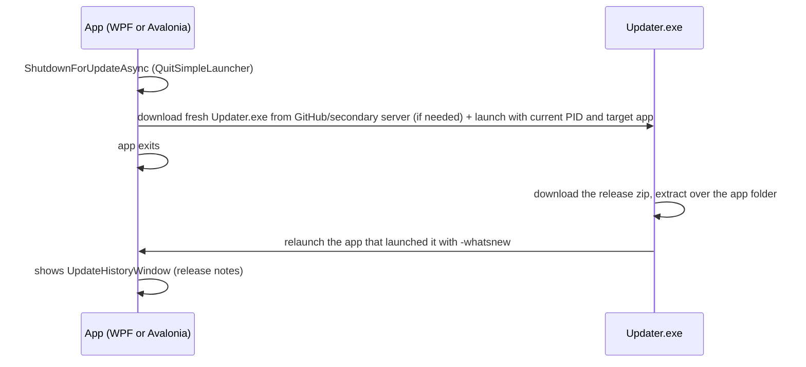

# 16 — Updater

> Update checking, the Updater.exe flow, restart/reinstall.
> Related: [04 — Architecture](04-architecture.md) · [15 — Development](15-development.md)

## Update check (`CheckForUpdatesService`)

`SimpleLauncher.Avalonia\Services\AvaloniaCheckForUpdatesService.cs` is the shipped implementation;
`SimpleLauncher\Services\CheckForUpdatesService.cs` remains the WPF reference.

- **Source fallback chain** (app + updater):
  1. GitHub API `https://api.github.com/repos/purelogiccode/SimpleLauncher/releases/latest` (primary repo),
  2. Secondary server `assets.purelogiccode.com/Simple Launcher/Simple Launcher/version.txt` (Cloudflare-hosted) — builds the release/updater URLs from it (`release_{version}_{rid}.zip` / `updater_{rid}.zip`).
- **Silent check** at startup. If every GitHub source is unreachable (offline, rate-limited, blocked), the check falls back to the secondary server.
- **Manual check**: About window "Check for Updates".
- **Rate limiting (investigated 2026-10-14)**: the GitHub REST API allows only **60 unauthenticated requests per hour per IP** (`HTTP 403 "API rate limit exceeded"`). Apps up to 5.6.0 have no fallback, so on a rate-limited/shared IP their check ends in "Error checking for updates" instead of the update window — for example a 5.6.0 run failed exactly this way right after a 5.7.0 run on the same IP. 5.6.1+ fall back to the secondary server on any non-success response, so keeping `version.txt` + the hosted packages in sync (see [15 — Development](15-development.md#release-workflow-from-git-history--whats-new)) is what makes update detection resilient to GitHub rate limits and outages.
- Version comparison against the current `5.9.0`; new version → prompts to download.
- **Missing platform assets**: a release is not required to ship every RID — when the latest release has no `release_{version}_{rid}.zip` / `updater_{rid}.zip` for the current platform, the check logs at Information and reports no update (LB-23) instead of an Error (which would also file a bug report).

## Update assets

The app reads the GitHub release, which ships the Windows and Linux bundles (portable
ZIP/tarball, AppImage and Flatpak), the macOS DMG, plus a standalone updater per Windows/Linux
RID:

- `release_{version}_{rid}.zip` — on Windows, the Avalonia app published as
  `SimpleLauncher.exe` plus the content files (`images/`, `tools/`, `samples/`,
  `appsettings.json`, …). The WPF project is no longer bundled. The app is a framework-dependent
  single executable (managed assemblies bundled; native libraries such as Skia/HarfBuzz ship
  beside the exe), so the .NET 11 runtime is required.
- `updater_{rid}.zip` - the single standalone `Updater.exe` (Windows) / `Updater` (Linux) (framework-dependent single file)
  used by the shipped app and legacy WPF installs. It bundles the Avalonia native libraries it needs (`libSkiaSharp.dll`,
  `libHarfBuzzSharp.dll`, `av_libglesv2.dll`, `IncludeNativeLibrariesForSelfExtract`) and
  self-extracts them at launch, so the one file runs from either app folder **and** on legacy
  WPF-only installs that never had those natives (which is how the old WPF updater asset name is
  reused for the current release). The updater zip also carries `LICENSE.txt`, `README.md` and
  `WhatsNew.md`.
- On Linux (`rid` = `linux-x64` / `linux-arm64`) the same asset names carry the framework-dependent
  single-file `SimpleLauncher.Avalonia` payload (managed assemblies bundled into the binary;
  native libraries such as Skia/HarfBuzz/SQLite ship beside it, same shape as the Windows exes)
  and the framework-dependent single-file `Updater`; the **.NET 11 runtime** is required, and the
  ZIP entries carry Unix permission bits (0755 for the executables) — see
  [15 — Development](15-development.md#linux-release-packaging-script).
- `release_{version}_linux-{x64,arm64}.tar.gz` — the portable Linux payload above as a tarball
  (same updater flow as the ZIP).
- `SimpleLauncher-{version}-linux-{x64,arm64}.AppImage` — the self-contained AppImage bundle.
  An AppImage install ignores the ZIP/Updater assets: it downloads the new AppImage beside the
  running file, replaces it atomically (the `APPIMAGE` environment variable points at the outer
  file) and restarts.
- `SimpleLauncher-{version}-linux-{x64,arm64}.flatpak` — the Flatpak bundle. Flatpak installs do
  not run the in-app updater check at all: a repository install updates through the software
  center (`flatpak update`), while a direct `.flatpak` bundle is refreshed by reinstalling the
  newer bundle (`flatpak install --user --reinstall ...`).
- `SimpleLauncher-{version}-osx-arm64.dmg` — the unsigned Apple Silicon bundle. macOS installs
  do **not** use the in-app updater: there is no `Updater` in the `.app`, silent/manual update
  checks point at the release page, and the user installs the next DMG over the old app. The
  DMG is mirrored to the fallback next to the other assets.
- The secondary fallback (`https://assets.purelogiccode.com/Simple%20Launcher/Simple%20Launcher/`)
  mirrors `version.txt` and the same assets (including the AppImages, which self-update from
  this copy). Publish it after packaging with `scripts/publish-fallback-r2.ps1` — see
  [15 — Development](15-development.md#cloudflare-r2-fallback-publishing).

## Update install flow

- `AvaloniaQuitSimpleLauncher` (shipped app) / `QuitSimpleLauncher` (WPF reference):
  - `RestartApplicationAsync` — spawns itself with `--restarting`, then shuts down; failed restart → "FailedToRestart" box, app stays alive; user-canceled launch (Win32 error 1223) → Information log + "FailedToRestart" box, app stays alive.
  - `ShutdownForUpdateAsync` — downloads a fresh `Updater.exe` from GitHub (fallback: secondary server), launches it with the current PID and the target executable name, kills the app.
- `ReinstallSimpleLauncher` (WPF) / `ReinstallAndShutdownAsync` (Avalonia):
  - `StartUpdaterAndShutdownAsync` / `LaunchUpdaterAndShutdownAsync` — launches the local `Updater.exe` or downloads it from GitHub/secondary server, then hard-exits; access-denied (error 5) → correct message box.
- AppImage installs take a different path: there is no `Updater` file in the read-only mount,
  so `AvaloniaCheckForUpdatesService` resolves `SimpleLauncher-{version}-{rid}.AppImage`,
  downloads it to `<appimage>.new`, applies the executable bit, renames it over the running
  file and starts it with `--restarting`. A failed download/replace shows the manual-download
  message and leaves the current AppImage untouched.
- Flatpak installs (`/.flatpak-info` or `FLATPAK_ID`) skip silent and manual update checks; a
  manual check points to the download page, and the software center owns the release channel.
- `--restarting` skips single-instance enforcement during startup; `-whatsnew` shows the release-notes window.
- The updater relaunches with `-whatsnew` (not `--restarting`), so the restarted app still goes
  through the shared single-instance guard: if another instance is somehow still alive, the
  relaunch exits and restores that instance instead of running two copies.

## `SimpleLauncher.Avalonia.Updater` project

The single updater (`Updater.exe`) used by the shipped app, also compatible with legacy WPF
installs. Responsibilities: fetch the latest release (GitHub API primary → secondary server as
fallback), download the release zip for the current RID (retrying from the secondary server if
the primary download fails), extract over the application folder, relaunch the app that launched
it. The launching app passes its PID as the first argument and the target executable name
(`SimpleLauncher.exe` on Windows; `SimpleLauncher.Avalonia` on Linux/macOS) as the second; older
WPF releases pass only the PID, so the updater detects the target from the process name. When an
old Windows Avalonia install passes `SimpleLauncher.Avalonia.exe`, the updater prefers the new
canonical `SimpleLauncher.exe` after extraction and restarts that. It was built from the Avalonia
codebase (cross-platform `net11.0` / `net11.0-windows`) and replaced the former WPF-specific
updater.
The updater excludes its own files (`Updater*`) during extraction so it can replace the
applications while running. Release-zip extraction is fail-closed against Zip-Slip: every entry
must resolve under the destination root, with a case-sensitive (Ordinal) prefix comparison on
Unix so a case-variant prefix (`/app/` vs `/APP/`) cannot pass. On Unix, a replaced file keeps
its live mode and a file added by the update receives the mode carried by the release zip
(0755 for executables), so newly bundled helper binaries stay executable.
- **Locked files**: extraction is staged and the live install is only swapped afterwards; before
  the swap the updater waits up to 30 s for any file still held open by another process (the
  application not fully exited, an antivirus scan, a second instance) to be released. A file that
  stays locked aborts the update with a manual-update prompt and an Information log — an expected
  user condition, never a bug report (#67442-67445).
- **Read-only files and transient denials (5.8.1)**: the swap clears the read-only attribute on
  both ends before every move/write and retries access-denied failures (antivirus/OneDrive
  filters, a closing handle) with backoff; only a persistent denial surfaces the actionable
  permissions error (#68287/#68288).
- **Interrupted swaps (5.8.1)**: a previous run's `.updbak` files are now recovered only for the
  exact destinations of the staged payload, instead of recursively scanning the whole install
  drive. Protected system folders (for example `D:\System Volume Information`) can no longer abort
  the update, and a missing live file is restored from its backup before the new swap
  (#68274/#68441). Staging cleanup clears read-only leftovers and stays at Information level
  (#68416).
- **Archive-viewer folders (5.8.1)**: if the app runs from WinRAR/7-Zip/Explorer zip temporary
  extraction, the updater refuses to install (the viewer deletes the folder when the app exits)
  and tells the user to extract the release ZIP to a permanent folder first (#68272). A restart
  `Win32Exception` "access denied" is classified as an expected environment condition with the
  same guidance, not a bug report.
- **Closed updater window (5.8.1)**: if the user closes the updater window mid-update, notices
  fall back to an ownerless dialog instead of throwing from `ShowDialog` (#68273).

Behavior parity with the dropped WPF updater is intentional: same Serilog setup (rolling warning
file + bug-report sink) and launch stats, same progress/log window with a Cancel button, the same
Dokan detection/install prompt after a successful update, the same retry/secondary-server
fallback, and the same global exception handling — including a UI-thread handler that logs,
reports the bug, shows the error dialog and exits with code 1 instead of vanishing. The app's
project reference uses `ReferenceOutputAssembly=false; Private=false` so the SDK does not copy
the updater's plain build sidecars into the publish output, and the publish step cleans the
updater's staging tree first because `dotnet publish` overwrites but never deletes
(`Remove-UpdaterSidecars` in `scripts/package-release.ps1` remains as a guard).

## Related docs

- [04 — Architecture](04-architecture.md) (startup/shutdown lifecycle)
- [15 — Development](15-development.md) (release packaging)
- [17 — Release Notes](17-release-notes.md)
